# Iteration 2 Wiki update draft

**Status:** repository handoff draft, 2026-10-19. The [live Requirements Wiki](https://github.com/snuhcs-course/swpp-2026-project-team-05/wiki/Requirements-and-Specifications) is still revision 0.1 and the [live Design Wiki](https://github.com/snuhcs-course/swpp-2026-project-team-05/wiki/Design-Documentation) still describes the Iteration 1 flow. This draft identifies specific changes for team review; it is not a claim that those Wiki pages have been updated. Code snapshot: [`53a5118`](https://github.com/snuhcs-course/swpp-2026-project-team-05/commit/53a5118), deployed as `dpl_4yj238Fa24XrGtQoQ4JxNdZb3DhB`; the latest emulator walkthrough used the older `c744cb3` debug APK. Recheck against the frozen demo revision before copying.

## Requirements and Specifications: proposed Revision 0.2

### Project scope and user journey

Keep the article-first purpose and evidence-oriented language. The Iteration 2 journey is: paste a public Korean article URL → wait for same-event discovery and evidence checks → read the **extracted text** of the chosen article → select a paired passage (with an A–G marker where a wording difference was verified) → inspect the corresponding passage in a related article panel → move among related articles and open their original links. A red I1 star can mark source content not observed in the verified comparison set; its wording must specify the number of compared articles. It is not a truth or bias verdict. The app does not recreate ads, images, interactive embeds, or the publisher's exact HTML layout.

### Proposed acceptance criteria to add after FR-06 (team approval needed)

| Candidate ID | Behavior to specify | Observable acceptance check |
| --- | --- | --- |
| FR-07: Read source text and inspect paired evidence | Show the extracted source title, publisher/link, and full extracted body. Tap a paired source sentence to open the related article excerpt at its matching sentence; show A–G only when a wording difference is verified. Allow expansion and horizontal navigation when more than one related article is linked. | In a fixed response with two linked articles, each paired-passage tap opens the correct article and sentence; swiping changes the selected article without changing the original source sentence; original links open the supplied URLs. If the article text is unavailable, show an explicit unavailable state. |
| FR-08: Understand source-only content | Mark source content with I1 ★ only when the backend reports a completed absence review over at least two independently verified same-event articles. Count rebuttal as coverage; show the comparison-set scope in the explanatory text. | A completed positive I1 result displays ★ with a scoped explanation; an uncertain, incomplete, or fewer-than-two-article review does not display ★. A missing star must not be described as proof that all sources covered the content. |
| FR-09: Distinguish incomplete analysis | Preserve `partial`, `unverified`, and no-match states through the API and UI. | A fixture with one failed comparison article keeps validated pairs from the others and visibly reports incomplete coverage; a search outage does not appear as a completed zero-match comparison. |

**Resolve before publication:** FR-02 currently says fewer than two related articles must show a no-related-coverage state. The newer Reader can have a useful one-article comparison, whereas I1 ★ specifically requires at least two independently verified articles. Decide whether a one-article result is a limited comparison or insufficient coverage, then align FR-02, FR-05, Android behavior, and tests. Do not silently weaken an existing acceptance criterion.

### Existing NFRs: keep targets and report measurement

- **NFR-02** currently requires a terminal state within 120 seconds in at least 8 of 10 prepared attempts. The older `2495c3a` production API run took 154.919 seconds; the later `c985903` API run took 240.141 seconds. With backend `53a5118`, the newest emulator loading capture was about 239 seconds before HTTP 200; the exact request-start timestamp was not recorded. All observed waits exceeded 120 seconds, but they are separate attempts through different clients, not the required ten-run app measurement. The `53a5118` observation does not establish a speed gain from four-worker verification. Retain the target and report the gap until the team deliberately changes it.
- **NFR-04/NFR-05** require two-person review of same-event selection and paired-passage relevance. Schema tests and literal quote validation are not substitutes. Prepare the five-event review set and record disagreements.
- **NFR-06/NFR-07** remain source link coverage and no verdict language. Inspect the Reader panel and I1 copy for both.
- **NFR-09** requires emulator and Galaxy S23. A single emulator recording cannot verify the device part.

## Design Documentation: proposed Revision 2.0

Replace the Iteration 1 component and request-flow sections with the current Reader path while retaining an explicit Iteration 1 history section.

```mermaid
flowchart LR
    A[Android URL input] --> B[Django POST /api/analyze]
    B --> C[Fetch and segment source article]
    C --> D[Source event and search plan]
    D --> E[NAVER discovery; structured web fallback]
    E --> F[Fetch candidate bodies; verify same event]
    F --> G[Select up to three displayed articles]
    G --> H[Reader: source content units]
    H --> I[Align each related full text]
    I --> J[Validate quotes; review A–G and I1 absence]
    J --> K[Reader response with offsets and status]
    K --> L[Android highlighted article and related panel]
```

| Current design point | Decision and boundary | Code reference |
| --- | --- | --- |
| Discovery versus evidence | NAVER metadata and structured web citations can find candidate URLs. Only downloaded article bodies are used for same-event, relation, A–G, and I1 evidence. An unavailable search path is recorded, not reinterpreted as no coverage. | [`article_search.py`](../server/analysis/article_search.py), [`pipeline.py`](../server/analysis/v2/pipeline.py) |
| Candidate verification | Fetch full body; distinguish same event, incidental mention, wrong event, and uncertain. Verify model-supplied quotes against source text. At most four independent candidate-verification calls run concurrently; verdicts are applied in candidate order, and diagnostic context is preserved across worker threads. This is a bounded implementation change, not a measured NFR-02 improvement. | [`comparison_selection.py`](../server/analysis/v2/comparison_selection.py), [`diagnostics.py`](../server/analysis/diagnostics.py), [`pipeline.py`](../server/analysis/v2/pipeline.py) |
| Reader alignment | Classify every source sentence's event scope, split central sentences into content units, then scan each displayed related article's full extracted body for `same`, `refutes`, `reframes`, `related_only`, `absent`, or `uncertain`. Only validated pairs receive A–G wording markers. Neutral reporting-verb pairs such as “말했다/설명했다” are withheld from A; a separate absence review gates I1 stars. The latest device walkthrough showed paired passages but no A–G or I1 visual marker. | [`reader_analysis.py`](../server/analysis/reader_analysis.py) |
| Text positions | Server sends extracted body, sentence spans, paragraph indices, and UTF-16 offsets. Android validates spans against that exact body and must not relocate them with a string search. Known Naver and YTN layouts now preserve paragraph breaks when safely recognized; other layouts fall back to the general extractor. These are extracted-text breaks, not a guarantee of pixel-identical publisher layout. | [`article_fetch.py`](../server/analysis/v2/article_fetch.py), [`reader_contract.py`](../server/analysis/reader_contract.py), [`AnalysisApi.kt`](../android/app/src/main/java/com/swpp/team5/frameless/data/AnalysisApi.kt) |
| Partial results | `execution_status`, `comparison_status`, `reader.coverage`, `reader.i1_status`, and article failures distinguish completed no-match from incomplete work. A failed annotation is withheld while validated article/pair data may remain. | [`v2_adapter.py`](../server/analysis/v2_adapter.py), [`AnalysisModels.kt`](../android/app/src/main/java/com/swpp/team5/frameless/data/AnalysisModels.kt) |
| Deployment and observability | Production backend `53a5118` is manually deployed; the latest emulator run used a `c744cb3` debug APK through `adb reverse` and a fixed-host localhost TLS bridge because the emulator did not trust the host's HTTPS inspection CA. Model keys stay server-side. Safe logs contain request IDs, stages, durations, call counts, and usage, not article body, prompts, responses, or credentials. Health reports configuration; the separate emulator run received HTTP 200 but a partial sentence-comparison warning. | [`views.py`](../server/views.py), [backend guide](backend.md), [testing draft](testing-documentation-iter2.md) |

Design trade-offs to state explicitly: synchronous analysis took roughly four minutes in the latest observed device run; search/index freshness and page extraction vary; a sourced passage does not establish the truth of a claim; A–G and relation meaning still need human evaluation; a publisher's HTML paragraphing may differ from extracted text; current I1 absence applies only to the source article and verified displayed comparison set. The latest response was partial, and no A–G or I1 visual marker was observed in the device walkthrough.

## Remaining Wiki pages: facts that need owners

- **Daily Standup Meeting Log:** The current page stops at 2026-10-05. Use meeting notes and participant review to add actual Iteration 2 dates, assignments, decisions, blockers, and follow-up. Commits alone cannot establish attendance or what someone said.
- **AI Collaboration Report / Prompt Log:** The current report's Iteration 2 section has no verified team examples. Each member should provide prompts or a summarized task, generated artifact, what they accepted/rejected, human verification, and final Git/PR evidence. Do not attribute another member's work to AI without their account.
- **Testing Documentation:** Keep this as a separate Wiki page and PDF. The repository [working draft](testing-documentation-iter2.md) is maintained by the testing owner. Avoid copying its older measurements into Design as if they were current.

## Publication check

Compare every statement above with the final code revision and real demo, then add the new Wiki revision rows. Resolve FR-02/FR-05 and NFR-02 decisions with the team. Update screenshots to the final Reader UI, cite the recorded test revision, and export PDFs only after the Wiki pages render correctly.
