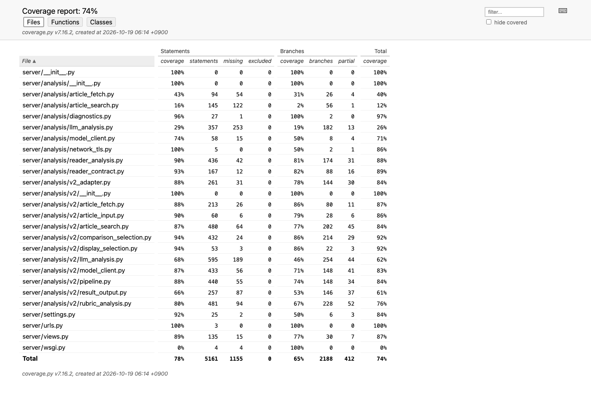
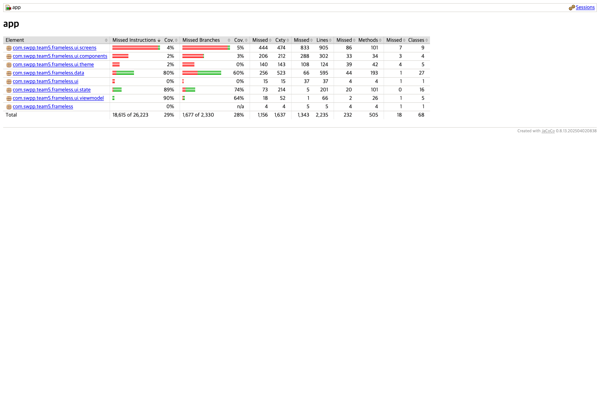

# FrameLESS Testing Documentation — Iteration 2 draft

**Status:** Repository draft, 19 October 2026 (KST). This is not yet the separate GitHub Wiki page or the PDF submitted to eTL. The offline coverage results below were measured on commit `29223a0`, the first live API smoke used deployment of `2495c3a`, and the later Android walkthrough used an APK and production backend built from application commit `c744cb3`. These are dated snapshots, not one test run on a single final submission commit. Re-run the offline commands and update results, screenshots, and device evidence after the final application changes are merged.

FrameLESS is an Android app that lets a reader start from one news article and inspect how other outlets cover the same event. The current reader displays extracted article text, verified corresponding sentences, A–G expression differences, and a cautious I1 star for source content not observed in at least two independent comparison articles. A refutation counts as coverage of that content. These markers are aids to reading, not judgments of an outlet's truthfulness. This document separates deterministic software checks from human assessment of the AI output.

## 1. Test responsibility and schedule — required in Iteration 2

### Plan

| Component | Proposed test owner | Responsibility |
| --- | --- | --- |
| Android API parser, reader state, and Compose interaction | Jinsol | Maintain Android unit and future device tests; review displayed evidence and navigation. |
| Retrieval, candidate verification, and the comparison pipeline | Junseo | Maintain deterministic backend tests around search, fetch, same-event selection, deadlines, and failures. |
| I1 and A–G interpretation | Seoyoung | Curate examples and review whether visible evidence supports the labels; prepare the later AI evaluation set. |
| Django API, cross-language contract, CI, and release smoke | Seungmin | Maintain endpoint and adapter tests, the shared fixture, coverage reports, and integration evidence. |

These assignments follow current feature responsibilities and **need confirmation by the team** before Wiki publication. The proposed rule is that the author of each feature or bug fix adds or updates its regression test in the same PR; a reviewer checks the relevant behavior and the evidence links. The PR should not merge until both CI jobs pass. The same offline suite should run on the final merge candidate and at the end of the iteration. A claimed end-to-end demo also needs one real API response and an Android device or emulator walkthrough. CI runs on every PR to `main` and every push to `main`; no nightly job is configured.

### Results — 19 October 2026

The offline commands in §2 passed locally on `29223a0`. CI passed for the merged testing-documentation/coverage-gate change ([PR #35](https://github.com/snuhcs-course/swpp-2026-project-team-05/pull/35)) and the later Reader UI change ([PR #34](https://github.com/snuhcs-course/swpp-2026-project-team-05/pull/34)). The GitHub Actions workflow has separate Django and Android jobs, uploads coverage/test artifacts, and builds an APK. A live production analysis and Android emulator walkthrough now provide device evidence for the main reader flow (§2). The response still reported partial search availability, and team ownership confirmation and an independent review of the article evidence remain pending.

## 2. Unit and integration testing — required in Iteration 2

### Plan

#### Test layers, tools, and goals

Python uses Django `SimpleTestCase` and the test client, `unittest.mock`, and coverage.py 7.16.2. Android uses JUnit 4, Robolectric 4.17 with Android SDK 35 for host tests, `org.json`, and JaCoCo 0.8.13. Django tests mock the model, NAVER/OpenRouter search, and article fetch at their boundaries. Android ViewModel tests use a fake API. A synthetic JSON response generated by the Python adapter test is parsed by `V2AdapterGoldenTest.kt`, catching schema drift across languages. None of these mocks establishes whether a model made the right editorial comparison.

| Production layer | Line-coverage goal | Main behavior checked |
| --- | ---: | --- |
| Django endpoint and v2 adapter | ≥85% | Request validation, status/errors, article IDs, links, partial states, and the Android response contract. |
| v2 retrieval and comparison package | ≥65% | Search, fetch, same-event verification, candidate selection, recovery, and safe failure handling. |
| Reader analysis and response contract | ≥65% | Grounded sentence alignment, UTF-16 spans, A–G evidence, and conservative I1 decisions. |
| Android data | ≥80% | JSON parsing, evidence and source identity, invalid spans, and optional fields. |
| Android presentation state | ≥85% | Article and issue grouping, empty/error states, and reader targets. |
| Android ViewModel | ≥60% | Loading, success, retry, cancellation, and stale-result handling. |
| Compose views and theme | ≥30% | Input, reader interaction, bottom sheet, source links, and error flows on a device. |

The first two backend goals and the Android goals above retain the earlier draft's targets. **Scope addition:** Reader became the default analysis path outside the `v2/` directory, so this revision adds its two production modules to the CI report with the existing analysis-layer target of 65%. The original v2-only number remains separately visible; it was not replaced by a more favorable combined figure. Logic layers have higher goals than Compose because host tests can exercise deterministic decisions directly, while rendered gestures and layout require device tests. The Compose target remains a goal even though the current CI gate reports it as an open gap rather than passing it.

Coverage includes production files in `server/` and the Android app's own classes. It excludes third-party dependencies, generated `BuildConfig`/`R` classes, and test source. Python's overall `server/` total includes legacy v1 modules; named groups isolate the current API, v2 package, and Reader. Android theme code stays in the Compose denominator. No active Reader code is excluded because it calls external services: model and network calls are replaced with test doubles for offline runs. Live calls are documented separately.

The integration strategy has three levels: Django's test client checks `POST /api/analyze` with a mocked pipeline; the Python-to-Android fixture checks the response contract; a live smoke checks the deployed API and then the installed APK. Live review should record the input URL, deployment and APK commits, date, response status, visible evidence, and any failure. It should confirm that a disputed or unverified sentence is not shown as a certain I1 omission or A–G difference. Test artifacts should contain neither credentials nor complete article bodies.

#### Reproducible offline commands

Use Python 3.12, JDK 21, Android SDK platform 37, and the repository root. Set `ANDROID_HOME` to the installed SDK location (the example is the default macOS path). The first dependency setup requires network access; these tests do not require live search/model keys. The branch CI uses the same test and coverage tasks.

```sh
python3.12 -m venv .venv
.venv/bin/python -m pip install -r requirements.txt 'coverage==7.16.2'
.venv/bin/python manage.py check
.venv/bin/python -m unittest discover -s ci -p 'test_*.py'

mkdir -p /tmp/frameless-iter2-coverage
COVERAGE_FILE=/tmp/frameless-iter2-coverage/data \
  .venv/bin/python -m coverage run --branch --source=server manage.py test --verbosity 1
COVERAGE_FILE=/tmp/frameless-iter2-coverage/data \
  .venv/bin/python -m coverage json -o /tmp/frameless-iter2-coverage/coverage.json
COVERAGE_FILE=/tmp/frameless-iter2-coverage/data \
  .venv/bin/python -m coverage html -d /tmp/frameless-iter2-coverage/html
.venv/bin/python ci/check_coverage.py python /tmp/frameless-iter2-coverage/coverage.json

export ANDROID_HOME="${ANDROID_HOME:-$HOME/Library/Android/sdk}"
cd android
./gradlew :app:jacocoDebugUnitTestReport :app:lintDebug :app:assembleDebug --no-daemon
cd ..
.venv/bin/python ci/check_coverage.py android \
  android/app/build/reports/jacoco/jacocoDebugUnitTestReport/jacocoDebugUnitTestReport.xml
```

Python test counts come from the Django and `unittest` outputs; covered/total **lines** come from `coverage.json`. Android test counts come from `android/app/build/test-results/testDebugUnitTest/*.xml`; covered/total lines come from JaCoCo XML `LINE` counters. The HTML pages and screenshots support the table below. The `coverage.py` overall percentage includes branches, and JaCoCo's HTML `Cov.` column counts instructions, so neither should be read as the layer-specific line figure.

### Results — 19 October 2026

**Offline revision:** `29223a0`. Django: **271 passed, 0 failed, 0 skipped**. CI coverage-gate self-tests: **4 passed, 0 failed, 0 skipped**. Android host JVM: **44 passed, 0 failed, 0 skipped**. `manage.py check`, Android lint, and debug APK build passed. No Android instrumented test ran: the only previous `androidTest` was a generated package-name assertion, which did not test FrameLESS behavior and was removed. The substantive Reader/parser/ViewModel tests remain. The coverage-gate change also ensures an absent Reader report fails rather than silently passing an unrelated v2-only target.

| Production layer | Goal | Actual lines | Result | Report |
| --- | ---: | ---: | --- | --- |
| Django endpoint + adapter | ≥85% | 350/396 = **88.4%** | Pass | coverage.py JSON, `server/views.py` + `server/analysis/v2_adapter.py` |
| v2 package | ≥65% | 2840/3444 = **82.5%** | Pass | coverage.py JSON, `server/analysis/v2/*.py` |
| Reader analysis + contract | ≥65% | 549/603 = **91.0%** | Pass | coverage.py JSON, `server/analysis/reader_analysis.py` + `reader_contract.py` |
| Android data | ≥80% | 529/595 = **88.9%** | Pass | JaCoCo XML, `data` |
| Android presentation state | ≥85% | 196/201 = **97.5%** | Pass | JaCoCo XML, `ui/state` |
| Android ViewModel | ≥60% | 65/66 = **98.5%** | Pass | JaCoCo XML, `ui/viewmodel` |
| Compose views and theme | ≥30% | 102/1368 = **7.5%** | **Below goal; open gap** | JaCoCo XML, `ui`, `ui/screens`, `ui/components`, `ui/theme` |





All `server/` production files together have **4006/5161 = 77.6% line coverage**; coverage.py reports **73.8%** when branch opportunities are included. All Android app production classes together have **892/2235 = 39.9% line coverage**. These whole-codebase totals are context, not substitutes for the layer goals. Compose is below its 30% goal because host tests cover mostly data/state and a few pure UI helpers; they do not drive actual Compose screens. Add device Compose tests for URL input, loading/error states, highlighted sentence tap, sheet swipe, article change, and original-link opening, then measure again. Until then, retain the shortfall in each iteration's results.

**First live API smoke, deployed application commit `2495c3a`:** on 19 October 2026, `GET https://frameless-team05-api.vercel.app/api/health` returned HTTP 200 and `analysis_ready=true`. This only confirms the reported configuration. A production `POST /api/analyze` for public URL `https://n.news.naver.com/article/057/0001971678` returned HTTP 200 in **154.919 s** (deployment `dpl_7pQfVS2swsCoJfb4paRgzGFPLDqn`). It included three related articles, two issues, two Reader highlights, and twelve aligned pairs; `i1_status=complete`, `coverage=all_source_sentences_reviewed`, zero I1 stars, and zero article failures. The analysis path reported `ready`, while overall execution was `partial` because NAVER and Google search returned HTTP 429 and OpenRouter Exa supplied fallback candidates. This observation proves a complete response was returned for one request at that time. It does **not** prove the articles were truly about the same event or that the I1/A–G interpretations were correct. No human-labeled accuracy result is claimed.

**Android emulator walkthrough, application commit `c744cb3`:** at approximately 06:31 KST on 19 October 2026, the installed debug APK requested the same public Naver URL from production deployment `dpl_6nby63pTjKmPhp3ZukMqYP3ksr1N`. The real API returned HTTP 200 with analysis ID `d6addbbd9c2f`, 15 Reader sentence pairs, three source highlights, and three comparison article pages. The Reader displayed its partial-result warning. Tapping a highlighted source passage opened the comparison sheet; horizontal swipes moved through pages 1/3, 2/3, and 3/3. Page 3/3 displayed an A-category difference note, and expanding the sheet displayed the related extracted article text. This is a successful walkthrough of the observed reader interactions for **one** response. It does not establish semantic correctness, I1 recall, behavior for other article URLs, or a completed original-article navigation.

The development host's HTTPS inspection certificate authority was not present in the emulator. For this debug walkthrough, `adb reverse` connected the APK to a local TLS bridge at `http://127.0.0.1:8765`; the bridge forwarded requests to the fixed production API URL and returned its actual response. This was **not** a mocked analysis, but the debug APK's network route differed from a release install. Tapping the original-article link launched Chrome; Chrome then showed a certificate warning, so the original page was **not** verified as readable. One related YTN extraction also retained publisher footer text. A proposed fix is in [PR #38](https://github.com/snuhcs-course/swpp-2026-project-team-05/pull/38); its CI was still running at the time of this update, and the fix had not been merged, deployed, or checked against a new live response. A 34-second screen recording, `FrameLESS-Iter2-live-demo-2026-10-19.mp4`, has been captured locally outside the repository. It has not been posted to GitHub, the Wiki, or eTL, and it records the pre-fix build rather than final submission evidence.

#### Current limitations and next checks

1. Repeat the device walkthrough with the exact final APK and backend revision after the YTN footer fix. Record the URL input, analysis wait, highlighted passage, comparison-article swipe, sheet expansion/collapse, and error/retry. Attach a screen recording and note deviations. Verify original-article navigation in an environment where the browser trusts the site certificate; the 19 October Chrome warning leaves that action unverified.
2. Review at least one live response against the original articles. Check same-event identity, exact quote spans, A–G difference descriptions, I1's independent-article count, and whether counterclaims are treated as observed. Record the reviewer and decision; a green schema test cannot replace this.
3. Add Compose device coverage and repeat the whole suite on the final submission commit. Update this table and both screenshots. If the Compose target remains unmet, retain the stated gap and plan in the Wiki/PDF.

## 3. AI module testing — first required in Iteration 3

The frozen evaluation set, thresholds declared before testing, model/prompt settings, exact command, and first measured results are due in Iteration 3. FrameLESS should use at least 30 immutable, source-backed article cases, with the annotation method and disagreement resolution discussed with the TA first. Exact output-string equality alone is insufficient. The 271 deterministic backend tests above are **not** an AI quality score.

## 4. Acceptance testing — plan first required in Iteration 3

Define at least five stable user stories, observable criteria, and tester procedures in Iteration 3. Per-story pass/fail results, dates, testers, and deviations first become due in Iteration 4.

## 5. Alpha and beta testing — first required in Iteration 5

Plan observed alpha sessions with course participants outside this team, fix serious issues, and then distribute a versioned beta build for independent use on external users' devices. Record participant numbers, tasks, feedback, severity, and verified fixes in Iteration 5.

## Publication checklist

- Confirm the proposed owners and the PR/release test policy with the team.
- Re-run the commands on the exact submission commit; update counts, dates, report screenshots, and any shortfall.
- Publish this **English** testing document as its own GitHub Wiki page, separate from Design Documentation. Link the images to repository URLs pinned to that commit.
- Export the Wiki page to PDF and submit that PDF on eTL for Iteration 2. A repository draft or PR alone is not the required submission.
