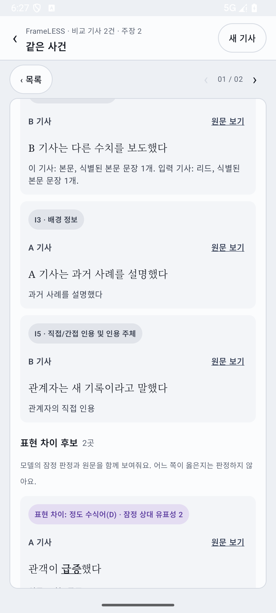
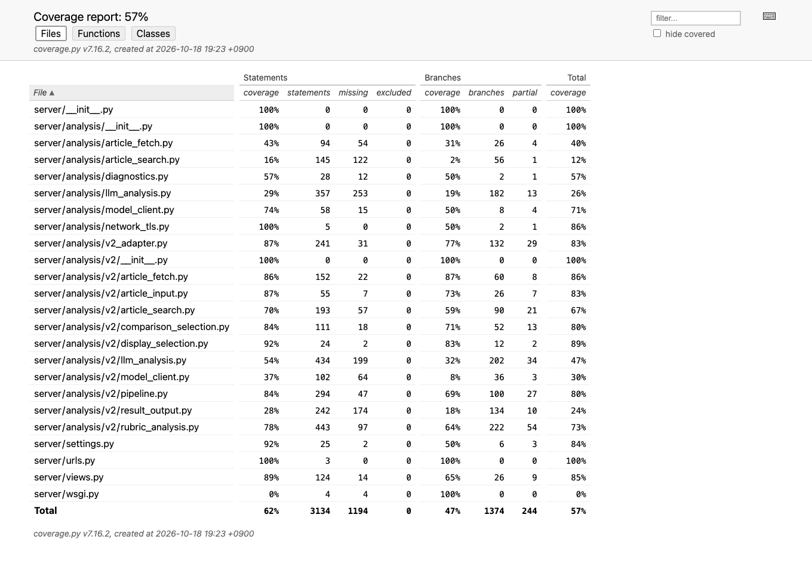
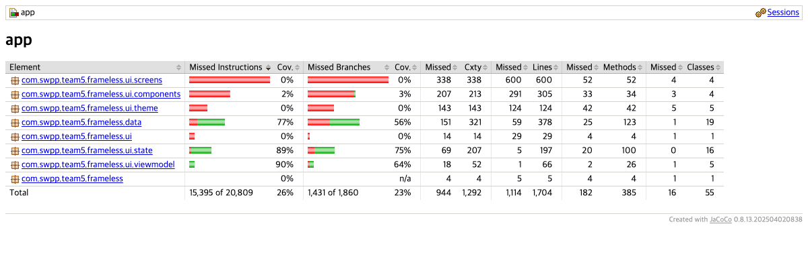

# FrameLESS Testing Documentation — Iteration 2 draft

**Status:** Working draft. The original integration measurement used commit `5eb473e` on 18 October 2026 (Asia/Seoul): 64 Django tests, 3 coverage-gate tests, and 25 Android host-JVM tests. A local follow-up candidate has separate measurements below. Rerun the commands on the final submission commit before Wiki/PDF publication.

This document follows the course *Testing Documentation Guidelines*. It is intended for developers and course staff. The plan and the measured results are separate so that future iterations can retain the original goals and explain any revisions.

## 1. Test responsibility and schedule (required from Iteration 2)

### Plan

| Component | Proposed test owner | Scope of ownership |
| --- | --- | --- |
| Android import, response parsing, and Compose UI | Jinsol Lee | Android data/UI tests and device-level user flows for UI changes. |
| Article retrieval, comparison selection, and LLM pipeline | Junseo | Deterministic pipeline tests with mocked NAVER/Gemini boundaries; AI evaluation preparation. |
| Information/expression rubric (I1–I5, A–G) | Seoyoung | Rubric examples, expected interpretations, evidence rules, and later human review of AI cases. |
| Django API, Android/backend contract, deployment integration | Seungmin Kim | API/error tests, cross-language fixtures, coverage reports, integration smoke tests, and release gate. |

These owners are proposed from current feature responsibilities and need team confirmation before Wiki publication; test ownership has not yet been formally assigned. The proposed policy is that the author of a feature or fix adds or updates its regression tests in the same PR. A reviewer checks that the test exercises the changed behavior and that any model-dependent assertion is grounded in a visible source passage. Seungmin coordinates the final cross-component run; ownership of a layer does not remove the author’s obligation to test their own changes.

`.github/workflows/verify.yml` runs on pull requests targeting `main` and pushes to `main`. Its Python 3.12 job checks Django configuration, runs three tests of the coverage gate, executes the Django suite with branch coverage, and **fails** if the endpoint/adapter or v2 package falls below the named line goals. The JDK 21 Android job runs JVM tests, JaCoCo, `lintDebug`, and a debug APK build; it **fails** if data, presentation state, or ViewModel coverage falls below their named line goals. Both jobs save test/coverage evidence, and the APK artifact is explicitly labeled as using the default backend without a live service check. The Compose UI goal remains an **open exception**: host-JVM coverage is reported as `OPEN GAP`, not treated as a passing 30% gate, until device tests can measure it. Run the same checks on each PR, the exact merge/demo candidate, and at iteration end. A release or demo that claims end-to-end analysis additionally needs a complete real backend result and an Android device/emulator walkthrough. The production API checks below produced partial results or an error, so that gate remains open.

### Results (18 October 2026)

The local offline gates passed on `5eb473e` (details in §2), and the [PR CI run for this revision](https://github.com/snuhcs-course/swpp-2026-project-team-05/actions/runs/39119062346) independently passed both jobs with the new coverage and lint gates. The merged [`main` CI run](https://github.com/snuhcs-course/swpp-2026-project-team-05/actions/runs/39120240079) also passed both jobs. No nightly job is configured. A manual `Medium_Phone` emulator walkthrough using synthetic v2 responses covered input → claim list → detail → I1–I5/A–G cards, a partial result with an explicit unverified I1 card, original-article link dispatch, an HTTP 503 error, retry, and recovery after editing the URL. The local mock received the link GET and retry POST. This checks the contract and UI path, not a live model request. The production API checks returned two partial comparisons and one error; live rubric validation and live Android remain open. Before submission, confirm owners and reviewer and rerun the checks on the named final commit.

## 2. Unit and integration testing (required from Iteration 2)

### Plan

#### Architecture, frameworks, and isolation

FrameLESS has an Android client (Kotlin/Compose), a Django JSON API, and a Python retrieval/comparison/rubric pipeline. The Android tests use JUnit 4, host-JVM `org.json`, Robolectric 4.17 for the ViewModel/Android looper (test SDK 35), and JaCoCo. Python tests use Django `SimpleTestCase`/test client, `unittest.mock`, and coverage.py. The current tests avoid paid and nondeterministic external calls by mocking Gemini and NAVER at the network/model boundary. Synthetic article text is used for contract cases. This validates mapping and error handling; it does not validate the factual quality of a model answer.

| Layer | Unit/integration cases to maintain | Line-coverage goal |
| --- | --- | ---: |
| Django HTTP endpoint and v2-to-Android adapter (`server/views.py`, `server/analysis/v2_adapter.py`) | JSON and URL validation, busy/retryable errors, v2 routing, stable article IDs, source URLs/quotes, claim IDs, conservative partial/unavailable states, rubric I1–I5/A–G mapping. | ≥85% |
| v2 pipeline package (`server/analysis/v2/`) | Fetch/search failure boundaries, same-event selection, per-claim comparison, schema and evidence validation, rubric exclusions, model error/timeout handling; mock external services. | ≥65% |
| Android data (`android/.../data/`) | Parse required/optional fields, reject unsafe links or conflicting IDs, preserve relations and quote provenance, retain nullable rubric markedness. | ≥80% |
| Android presentation state (`android/.../ui/state/`) | Claim-to-card grouping, article counts, quoted speech handling, empty/error states, optional question grouping. | ≥85% |
| Android ViewModel (`android/.../ui/viewmodel/`) | Loading, success, retryable error, cancellation, and stale-response handling with a fake API. | ≥60% |
| Compose views and theme (`android/.../ui/`, excluding `state` and `viewmodel`) | Import, loading, comparison, source-link and status flows in device/emulator tests. | ≥30% |

These are **line** coverage goals for production source, not test count or model accuracy goals. They are retained as the plan for the next measurement; failing a goal is reported below. JaCoCo excludes generated `BuildConfig`/`R` classes. Both tools exclude third-party libraries and test source. Python's `--source=server` includes the legacy v1 modules and Django plumbing in the overall total; the v2 package is reported separately because it is the Iteration 2 implementation. Theme code remains in the Compose denominator. No production code is silently omitted because it needs external services: those branches require fakes/mocks or a separate live integration run.

The contract integration path is covered in two ways. Django's test client exercises `POST /api/analyze` with a mocked pipeline and checks HTTP status and response structure. A checked-in synthetic JSON fixture is emitted from the Python v2 adapter test and parsed in the Android JVM test (`tests/test_v2_adapter.py` ↔ `android/app/src/test/resources/v2_android_response.json` ↔ `V2AdapterGoldenTest.kt`). This catches cross-language schema drift but does not execute the HTTP transport, Android Compose UI, Gemini, or NAVER together.

The planned live integration scenarios are: (1) `GET /api/health` confirms configured keys; (2) a public Korean-news URL gives verified same-event articles and clickable original sources; (3) claims remain attached to the correct source evidence and article identity, including `same_issue`; (4) absent or unverified evidence is not presented as an omission or score of zero; (5) model/search failures appear as errors or partial states rather than “no matches”; (6) the same response is inspected on an emulator/device for navigation and readable UI. Record the URL, backend deployment commit, Android APK commit, response ID, date, and observed result. Do not store credentials or complete article bodies in test output.

#### Reproducible offline commands

Use Python 3.12, JDK 21, Android SDK 37, and the repository root as the working directory. Before the Gradle command, point `ANDROID_HOME` to the installed Android SDK, **or** create `android/local.properties` with `sdk.dir` set to its absolute path. Without one of these, Gradle fails before testing because it cannot locate the SDK. Robolectric downloads its Android 35 test runtime during dependency setup. The first dependency install needs network access; the test runs themselves do not need Gemini/NAVER keys. `coverage.py` is a measurement tool installed separately for this draft, so its pinned version is included explicitly.

```sh
python3.12 -m venv .venv
.venv/bin/python -m pip install -r requirements.txt
.venv/bin/python -m pip install 'coverage==7.16.2'
.venv/bin/python -m unittest discover -s ci -p 'test_*.py'

mkdir -p /tmp/frameless-iter2-coverage
COVERAGE_FILE=/tmp/frameless-iter2-coverage/data \
  .venv/bin/python -m coverage run --branch --source=server manage.py test --verbosity 0
COVERAGE_FILE=/tmp/frameless-iter2-coverage/data \
  .venv/bin/python -m coverage report -m
COVERAGE_FILE=/tmp/frameless-iter2-coverage/data \
  .venv/bin/python -m coverage json -o /tmp/frameless-iter2-coverage/coverage.json
COVERAGE_FILE=/tmp/frameless-iter2-coverage/data \
  .venv/bin/python -m coverage html -d /tmp/frameless-iter2-coverage/html
.venv/bin/python ci/check_coverage.py python /tmp/frameless-iter2-coverage/coverage.json

cd android
./gradlew :app:jacocoDebugUnitTestReport :app:lintDebug :app:assembleDebug
cd ..
.venv/bin/python ci/check_coverage.py android android/app/build/reports/jacoco/jacocoDebugUnitTestReport/jacocoDebugUnitTestReport.xml
```

Python test output is the test-count evidence. Python per-file executed/total **statement** counts come from `coverage.json` (`summary.covered_lines` / `summary.num_statements`); add the numerators and denominators of the named files for each Python layer in the table below. The coverage.py console/HTML `Cover` column also includes branch opportunities because `--branch` is enabled, so its total percentage differs from the line-only figures. Android counts come from each package's `LINE` counter in `android/app/build/reports/jacoco/jacocoDebugUnitTestReport/jacocoDebugUnitTestReport.xml`; JUnit results are in `android/app/build/test-results/testDebugUnitTest/`. Keep a screenshot of each coverage report with the exported Wiki/PDF. Local HTML reports and `/tmp` data are generated evidence, not checked-in artifacts.

### Results (updated Iteration 2 measurement, 18 October 2026)

**Tested code revision:** `5eb473e` on 18 October 2026. The Django command ran **64 tests: 64 passed, 0 failed, 0 skipped**; the coverage-gate command ran **3 tests: 3 passed**. The Android command ran **25 host-JVM tests: 25 passed, 0 failed, 0 skipped**; `:app:lintDebug` and `:app:assembleDebug` succeeded. Lint reported 13 warnings and no errors; these include unused starter colors and dependency/catalog notices, with no blocking finding. No automated instrumented Android test was run. The earlier manual emulator smoke used synthetic HTTP data and passed after reinstalling the fixed APK.



A separate live **input-stage-only** smoke on 18 October fetched and extracted one public news URL, `https://n.news.naver.com/article/057/0001971678`, using `server.analysis.v2.article_input.prepare_article`. It returned a title, 10 segmented sentences, and a 1,055-character body in 2.4 seconds. This verifies that one article could be fetched and structured at that time. The page or network may change, and this check did not call NAVER search, Gemini, comparison, or the rubric. It is not an end-to-end result. To repeat the attempt without logging article text:

```sh
.venv/bin/python - <<'PY'
from time import perf_counter
from server.analysis.v2.article_input import prepare_article
started = perf_counter()
article = prepare_article('https://n.news.naver.com/article/057/0001971678')
print({'has_title': bool(article.get('title')),
       'sentences': len(article['sentences']),
       'body_chars': len(article['body']),
       'seconds': round(perf_counter() - started, 1)})
PY
```

**Deployed v2 API checks, 18 October:** after PR #10 merged into `main` at `6b75cb9`, Vercel deployment `dpl_CLRDb49URZgPUgNfwa8Q9y87ccQM` at the existing production URL gave the results below. The requests used public NAVER news articles. `GET /api/health` returned HTTP 200 with `analysis_ready=true`; this reports configured analysis credentials, not a successful end-to-end analysis. `GET /api/analyze` returned HTTP 405. A malformed JSON body and a localhost article URL each returned HTTP 400 (`invalid_json` and `invalid_url`, respectively).

| Production `POST /api/analyze` input | HTTP / elapsed | Analysis ID | Observed response |
| --- | --- | --- | --- |
| `https://n.news.naver.com/article/057/0001971678`, `max_related=3` | 200 / 46.3 s | `696495f106e5` | Three source claims, three related articles, comparison available; no completed rubric. `rubric_analysis` reported `ANALYSIS_RESPONSE_INVALID`, and `execution_status` was `partial`. |
| Same article, `max_related=1` | 200 / 33.515 s | `adb4639bb53c` | Three source claims, one related article, comparison available; no completed rubric. `rubric_analysis` reported `ANALYSIS_RESPONSE_INVALID`, and `execution_status` was `partial`. |
| Second public NAVER article (`079/0004199926`), `max_related=3` | 502 / 2.564 s | `9609ca3a77a0` | API error code `analysis_response_invalid`; no comparison or rubric response was returned. The response alone does not identify the failing stage. |

These observations confirm that comparison completed for the first article on two requests, while a complete live rubric has not been observed. They do not establish comparison accuracy, source attribution quality, or the cause of the 502. The local follow-up candidate below was **not** deployed for these checks. An Android request against the deployed backend has not completed because of an HTTPS certificate trust error on the current local emulator. Repeat the Android walkthrough on a suitable network or device, and record source-review findings with the final live-test evidence.

**Local follow-up candidate, not deployed:** a related article whose I1–I5 model response still fails evidence validation after one repair is marked unverified; validated source and other article rows remain. A source article failure still stops the rubric. A claim's A–G expression failure now preserves its verified I1–I5 rows and other claims, with A–G withheld for that claim and explicitly marked unverified on Android. Model 429 and temporary-unavailable failures at this stage remain retryable. Stage, safe code, and exception class are logged without raw model or article text. Synthetic regression cases cover these paths, the Android partial-card parser, and a readable SSL error message. On this branch, **72 Django tests** and **30 Android host-JVM tests** passed with no failures; Django configuration, three coverage-gate self-tests, Android lint, and APK build passed. The Python coverage gates passed: backend endpoint/adapter **88.2%**, v2 package **71.1%**. Android data/state/ViewModel coverage was **85.2%/97.5%/98.5%**; Compose UI remains an open gap at **1.3%**. In a second manual synthetic walkthrough, [claim C1 displayed A–G as unverified](testing-assets/android-ag-unverified-synthetic.png) while [claim C2 retained its expression candidate](testing-assets/android-ag-other-claim-synthetic.png). The screenshots are local mock results, not real article evidence. Rerun these gates on the named final submission commit. These offline checks do not establish which stage caused the live rubric failure or that the revised code succeeds live.

**Backend hardening follow-up, not deployed (18 October):** the local v2 candidate adds at most one format repair for a model task and shares that allowance with source/article information grounding repair, preserves verified comparison batches after a later verification failure or deadline checkpoint, uses a 240-second soft execution budget, records safe stage/call metrics without retaining production prompts, and blocks private-address or proxied article fetches. NAVER credentialed search redirects are rejected. Synthetic tests cover these boundaries, provider transport failures, and partial-response contracts. On this candidate, **113 Django tests passed**, Django configuration and the three coverage-gate self-tests passed, and line coverage reached **88.2%** for the endpoint/adapter and **76.1%** for the v2 package; both gates passed. Android source was unchanged from the 30-test candidate, but its CI job must run again on the committed PR revision. This is an offline reliability result. No live Gemini/NAVER analysis or real Android service walkthrough has passed on this candidate. The budget is soft, and the public API still lacks a shared rate limit.

| Production layer (line coverage; original `5eb473e` baseline) | Goal | Actual | Result | Report source |
| --- | ---: | ---: | --- | --- |
| Django HTTP endpoint + adapter | ≥85% | 320/365 = **87.7%** | Met, CI gate | Python JSON: `server/views.py` + `server/analysis/v2_adapter.py` |
| v2 analysis package | ≥65% | 1363/2050 = **66.5%** | Met, CI gate | Python JSON: `server/analysis/v2/*.py` |
| Android data | ≥80% | 319/378 = **84.4%** | Met, CI gate | JaCoCo XML: `.../data` |
| Android presentation state | ≥85% | 192/197 = **97.5%** | Met, CI gate | JaCoCo XML: `.../ui/state` |
| Android ViewModel | ≥60% | 65/66 = **98.5%** | Met, CI gate | JaCoCo XML: `.../ui/viewmodel` |
| Compose views and theme | ≥30% | 14/1058 = **1.3%** | **Below goal; open exception** | JaCoCo XML: `.../ui`, `.../ui/screens`, `.../ui/components`, `.../ui/theme` |



The Python coverage screenshot rounds whole-server statement coverage to 62% and shows **57% total** when branch opportunities are included. The table uses statement/line coverage; `coverage.json` gives the exact whole-server value of 1,940/3,134 = 61.9%.



The JaCoCo HTML screenshot's `Cov.` column reports **instruction coverage** (26% overall), while this document's goals and actual percentages use the XML `LINE` counters. The screenshot reports 1,114 missed lines out of 1,704 total, giving 590/1,704 = 34.6% line coverage.

Context for the denominators: all `server/` production files together are **1940/3134 = 61.9% line coverage**; the combined line-and-branch coverage shown by coverage.py is **57.3%** (rounded to 57% in HTML). All Android app production packages together are **590/1704 = 34.6% line coverage**. Android data/state alone is **511/575 = 88.9%**; it must not be described as whole-app coverage.

The currently passing regression cases include URL/redirect rejection, HTTP body/configuration/concurrency errors, transient Gemini error handling without article text in logs, v2 evidence and article-ID mapping, partial rubric status, rubric evidence links and nullable markedness, direct-quote and speaker attribution, conservative “no matches” behavior, display selection that covers distinct claims, a cap on expensive rubric calls, and a withheld I1 judgment when analysis stages disagree. Android tests cover grouping and the shared Python-to-Android fixture. `AnalysisViewModelTest.kt` exercises loading, successful analysis, and error/retry state with a fake API. The 29 tests in `tests/test_v2_pipeline.py` exercise deterministic retrieval, selection, comparison, rubric, and pipeline branches with external services mocked. The v2 package meets its line-coverage goal, but `result_output.py`, `model_client.py`, and some LLM branches remain comparatively weak. The v2 model prompts, search ranking, and output quality have not been validated by these green tests. The host-JVM tests exercise 14 Compose-component lines, while Compose screens/theme remain at 0%; this is an open test gap, not an exclusion from the denominator.

**Follow-up before treating the demo as verified:** identify the exact live `rubric_analysis` validation failure and rerun with the revised code in an appropriate test environment; review the comparison and rubric against original sources; complete a real Android walkthrough on a suitable network or device; expand deterministic v2 pipeline coverage for selection and failure cases; add automated Compose UI tests; rerun both suites and regenerate report screenshots on the named final candidate commit. The partial API result and synthetic UI walkthrough do not substantiate a complete demo.

## 3. AI module testing (first required in Iteration 3)

Plan and first results are due in Iteration 3. Before running an evaluation, commit a frozen set of at least 30 article cases with expected behavior or reference labels, the label/review procedure, model and prompt versions, temperature/seed, assertion method, and numerical thresholds. Do not edit or remove submitted cases; record later additions. Exact string equality alone is insufficient as an assertion method. Synthetic contract tests in §2 are **not** an AI-quality evaluation. Discuss the ground-truth method with the TA in advance because FrameLESS compares framing and evidence rather than producing a simple objective label.

## 4. Acceptance testing (plan first required in Iteration 3)

At least five stable user stories, observable pass criteria, and tester procedures will be specified in Iteration 3. Per-story results are first due in Iteration 4.

## 5. Alpha and beta testing (first required in Iteration 5)

The participant plan, distribution/version, procedures, feedback handling, and execution results will be completed in Iteration 5. Alpha participants must be outside this team but within the course; beta users test independently on their own devices.

## Submission checklist for this draft

- Keep the tested code revision identified as `5eb473e` in the Wiki/PDF, or rerun and update all results if later code is submitted.
- Confirm proposed test owners and the PR/merge test policy with the team.
- Confirm the included Python and JaCoCo report screenshots still correspond to the code revision submitted in the Wiki/PDF.
- When copying this draft to the Wiki, replace local image paths with repository image URLs pinned to the submission commit so they appear in the Wiki/PDF.
- Publish this in English as a **separate GitHub Wiki page** from Design Documentation and export that page as a PDF for the Iteration 2 eTL submission.
- Preserve the original plan and record any later target changes with a reason in that iteration's Results section.
